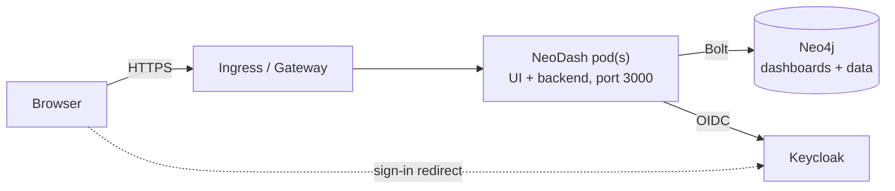

# Deploying NeoDash

This guide covers deploying this fork of NeoDash: how it differs from upstream NeoDash 2.4,
installing it on Kubernetes with Helm (connected or air-gapped), connecting Keycloak, operating it,
and the CI pipeline that builds and publishes it.

- Chart reference (every value): [`k8s-deploy/neodash/README.md`](../k8s-deploy/neodash/README.md)
- Backend settings and API: [`server/README.md`](../server/README.md)
- Local dev stack with sample data: [`dev/README.md`](../dev/README.md)

## Contents

1. [What changed from upstream NeoDash](#what-changed-from-upstream-neodash)
2. [Compatibility with existing dashboards](#compatibility-with-existing-dashboards)
3. [Prerequisites](#prerequisites)
4. [Identity provider (Keycloak)](#identity-provider-keycloak)
5. [Install](#install)
6. [Exposing NeoDash: Ingress or Gateway API](#exposing-neodash-ingress-or-gateway-api)
7. [Air-gapped clusters](#air-gapped-clusters)
8. [Security model](#security-model)
9. [URLs, browser titles and audit logs](#urls-browser-titles-and-audit-logs)
10. [Branding and appearance](#branding-and-appearance)
11. [Operations](#operations)
12. [CI/CD: building, publishing and deploying](#cicd-building-publishing-and-deploying)
13. [Migrating from upstream NeoDash or chart 1.x](#migrating-from-upstream-neodash-or-chart-1x)
14. [Troubleshooting](#troubleshooting)

## What changed from upstream NeoDash

Upstream NeoDash is a browser-only app: each browser connects straight to Neo4j with credentials
typed in or baked into `config.json`, and read-only access needs a separate "standalone" deployment.
This fork adds a small backend and serves the UI from it:



| | Upstream NeoDash 2.4 | This fork |
| --- | --- | --- |
| Neo4j access | From every browser, with a password in the browser or `config.json` | Only from the backend; the password comes from a Kubernetes Secret and never reaches browsers |
| Sign-in | Neo4j login form, or Neo4j SSO | OIDC (Keycloak or any OIDC provider) |
| Viewer / editor | Two deployments (standalone mode for viewers) | One deployment; each user's role (`neodash-viewer` / `neodash-editor`) decides |
| Multiple dashboards | Load by name or from a list in the sidebar | Start page listing every dashboard, plus a sidebar switcher; each dashboard has its own URL |
| Links and history | One URL for everything | `/dashboards/<uuid>?page=…&neodash_<param>=…`; back/forward work; titles name the dashboard and page |
| Audit | None | JSON audit lines for sign-ins, views, saves, deletes and every query |
| Exposure | Port 5005 (often a LoadBalancer) | ClusterIP behind ingress-nginx (or any Ingress controller) or a Gateway API HTTPRoute, with TLS |
| Image | nginx, runs as root by default | Distroless Node.js, UID 65532, read-only root filesystem, no shell |
| Offline | Fonts, map tiles and some assets fetched from the internet | No outbound requests; map tiles optional from an internal server |
| Look and feel | Fixed light theme, per-dashboard dark mode | Refreshed UI, per-user light / dark / system appearance with WCAG AA contrast |

Other improvements users will notice:

- Saving: a **Save** button and an unsaved-changes indicator in the header.
- Tables: a **Rows per page** setting (default 25). Each reader's own choice is remembered in their browser per table.
- Charts, code editors, maps and graphs follow the light/dark appearance; rule-based row and cell colours keep readable text.
- Many fixes to legacy quirks; see [the table in `dev/README.md`](../dev/README.md#legacy-quirks-found-while-building-the-fixtures).

## Compatibility with existing dashboards

Upgrading is non-breaking for dashboards:

- Dashboards stay where they are: `_Neodash_Dashboard` nodes in Neo4j, in the same format. The
  backend saves with the same `MERGE` as NeoDash 2.4, so you can run 2.4 and this version side by
  side against the same database while you migrate.
- Existing `?neodash_<param>=value` deep links still set parameters.
- Report types, settings, extensions and rule-based styling behave as before.

Intended differences:

- The dashboard's own **dark mode** setting is ignored; each user picks their appearance.
- Tables show **25 rows per page** instead of 5. To restore the old behaviour for a report, set
  *Rows per page* to 5 in its advanced settings.
- Viewers can't use features that build Cypher in the browser: graph "expand node", graph editing
  and the forms extension need the editor role.
- Browser-side connection settings (`config.json`, `standalone*`, `ssoEnabled`, `?share=` links
  carrying credentials) no longer apply: the backend owns the connection.

## Prerequisites

- Kubernetes 1.25+ and Helm 3.
- Neo4j 5 (Community or Enterprise) reachable from the cluster. Community has a single database
  (`neo4j`), which holds both the dashboards and your data.
- A Neo4j user for NeoDash. Editors can run any Cypher, so give it the access your editors need.
  Viewers are limited to saved queries in read transactions regardless of the user's permissions.
- An OIDC provider (Keycloak below).
- Either an Ingress controller (e.g. ingress-nginx) or a Gateway API implementation, and a TLS
  certificate for the host name.
- Access to the NeoDash image: `ghcr.io/<owner>/neodash`, or a mirror in your own registry.

## Identity provider (Keycloak)

In your realm:

1. **Create a client**: *Clients → Create client*, type OpenID Connect, client ID `neodash`.
   Turn on *Client authentication* (a confidential client) and *Standard flow*.
   - Valid redirect URIs: `https://neodash.example.com/auth/callback`
   - Valid post-logout redirect URIs: `https://neodash.example.com/*`
   - Web origins: `https://neodash.example.com`
2. **Create roles** `neodash-viewer` and `neodash-editor`. Assign them to users, or better, to
   groups.
   - Realm roles appear in the `realm_access.roles` claim, the chart's default.
   - For client roles (on the `neodash` client), set `oidc.rolesClaim: resource_access.neodash.roles`.
   - Different role names: set `oidc.roles.viewer` / `oidc.roles.editor`.
   - A user with both roles is an editor. A user with neither sees "No access" (and an
     `auth.login.denied` audit line).
3. **Copy the client secret** from the client's *Credentials* tab.

Roles are read at sign-in. Changing a user's roles takes effect at their next sign-in, at the latest
after `session.maxAgeSeconds` (8 hours by default).

**API access.** Scripts can call the API with a Keycloak access token issued to the `neodash`
client: `Authorization: Bearer <token>`, with the same role rules. See
[`server/README.md`](../server/README.md#api).

**Internal URLs and CAs.** If the pods reach Keycloak at a different URL than browsers do (e.g. the
in-cluster service), set `oidc.discoveryUrl`; the issuer must still be `oidc.issuerUrl`. If
Keycloak's certificate comes from an internal CA, provide the CA bundle with
`oidc.caBundle.existingSecret` or `existingConfigMap`. The bundle is also trusted for `neo4j+s://`.

## Install

### 1. Secrets

The chart never takes credentials as values. Create them first (or with your secrets tooling, e.g.
External Secrets or Sealed Secrets, using the same names and keys):

```sh
kubectl create namespace neodash

kubectl -n neodash create secret generic neo4j-credentials \
  --from-literal=username=neodash --from-literal=password='<neo4j password>'

kubectl -n neodash create secret generic neodash-oidc \
  --from-literal=client-secret='<keycloak client secret>'

# TLS certificate for the host (skip if cert-manager issues it, or the Gateway terminates TLS)
kubectl -n neodash create secret tls neodash-tls --cert=tls.crt --key=tls.key
```

The session key (which encrypts the sign-in cookie) is generated on first install and kept across
upgrades. For GitOps tools that render charts without cluster access (Argo CD, Flux with
post-rendering), create it yourself and set `session.existingSecret`, otherwise each render
produces a new key and signs everyone out:

```sh
kubectl -n neodash create secret generic neodash-session \
  --from-literal=session-secret="$(openssl rand -base64 48)"
```

### 2. Values

`my-values.yaml`, the minimum:

```yaml
image:
  repository: <owner>/neodash # on ghcr.io; or set image.registry for a mirror
publicUrl: https://neodash.example.com
neo4j:
  uri: neo4j://neo4j.neo4j.svc.cluster.local:7687
  auth:
    existingSecret: neo4j-credentials
oidc:
  issuerUrl: https://keycloak.example.com/realms/acme
  existingSecret: neodash-oidc
ingress:
  host: neodash.example.com
  tls:
    secretName: neodash-tls
```

If the image is private (GHCR packages are private by default), add a pull secret:

```sh
kubectl -n neodash create secret docker-registry ghcr \
  --docker-server=ghcr.io --docker-username=<user> --docker-password=<token with read:packages>
```

```yaml
imagePullSecrets:
  - name: ghcr
```

### 3. Install the chart

From the published chart (released versions, and `-dev.N` builds from `master`):

```sh
helm install neodash oci://ghcr.io/<owner>/charts/neodash --version <chart version> \
  -n neodash -f my-values.yaml
helm test neodash -n neodash
```

Or from a checkout: `helm install neodash k8s-deploy/neodash -n neodash -f my-values.yaml`.

The chart stops with a clear message if a required value is missing. `helm test` checks the
service answers and NeoDash can reach Neo4j. Then open the URL and sign in.

Pin the image by digest for production (`image.digest: sha256:…`); the digest of every published
image is in the CI run summary and the GitHub Release notes.

## Exposing NeoDash: Ingress or Gateway API

The UI, API (`/api`) and sign-in (`/auth`) share one host and one path (`/`), so the session cookie
and the backend's same-origin checks work without extra routing. `publicUrl` must be the URL users
open.

### ingress-nginx (default)

`ingress.className: nginx` with these default annotations:

| Annotation | Value | Why |
| --- | --- | --- |
| `proxy-body-size` | `20m` | Dashboards are saved as one JSON document |
| `proxy-read-timeout` | `150` | Queries may run up to `query.timeoutSecondsMax` (120 s) |
| `proxy-buffer-size` | `16k` | The sign-in response sets a session cookie of up to ~4 KB, more than nginx's default buffer |

No sticky sessions are needed: pods are stateless and share the session key.

### Other Ingress controllers

Set `ingress.className` and replace `ingress.annotations` with your controller's equivalents of the
three settings above (request body size, upstream read timeout, response header buffer).

### Gateway API (HTTPRoute)

The ingress-nginx project was retired in March 2026 and no longer gets fixes. On clusters
moving to the Gateway API (Envoy Gateway, Istio, Cilium, NGINX Gateway Fabric, …), attach an
HTTPRoute to an existing Gateway instead:

```yaml
ingress:
  enabled: false
httpRoute:
  enabled: true
  parentRefs:
    - name: shared-gateway
      namespace: gateway-system
      sectionName: https # the Gateway's HTTPS listener; the Gateway holds the certificate
  timeouts:
    request: 150s # if your implementation supports route timeouts
```

The host name defaults to the host of `publicUrl`. With `networkPolicy.enabled`, set
`networkPolicy.ingressFrom` to the namespace of the Gateway's data-plane pods.

## Air-gapped clusters

Nothing in the running system needs internet access:

- The image contains the UI, fonts and backend, and makes no outbound requests. The chart uses no
  other images (`helm test` reuses the NeoDash image).
- Sign-in only talks to your identity provider.
- Map reports (drawn with MapLibre GL, which needs a WebGL2-capable browser, as all current
  browsers are) draw no background tiles unless you set `maps.tileUrl` to an internal tile server.
- Choropleth and area-map reports load country and region shapes from the image itself
  (`/maps`, about 8 MB, sent compressed at under 1 MB). Set `maps.dataUrl` only to serve them
  from elsewhere.
- The optional text-to-Cypher extension calls an external LLM only if an editor configures it.

Each release on GitHub has an offline bundle, `neodash-offline-<version>.tar.gz`, containing the
image (`docker save`), the packaged chart, `SHA256SUMS` and `INSTALL.md`. To build one yourself, on a
connected machine with Docker and Helm, run `scripts/offline-bundle.sh` from the repository root.
To package an already-published image instead of rebuilding, set
`SOURCE_IMAGE=ghcr.io/<owner>/neodash:<version>`.

Then, inside the air gap:

```sh
sha256sum -c SHA256SUMS
docker load -i neodash-image-<version>.tar
docker tag neodash:<version> registry.internal:5000/neodash:<version>
docker push registry.internal:5000/neodash:<version>
# or, without Docker:
skopeo copy docker-archive:neodash-image-<version>.tar docker://registry.internal:5000/neodash:<version>

helm install neodash neodash-<chart version>.tgz -n neodash -f my-values.yaml \
  --set global.imageRegistry=registry.internal:5000 --set image.repository=neodash
```

## Security model

- **Roles.** Viewers list and open dashboards and change parameter values. The backend only runs the
  query saved in the report they're viewing, in a read transaction, with their parameters. Editors
  can also run any Cypher, and save and delete dashboards.
- **Dashboard authors:** a saved query that executes a parameter as Cypher (e.g.
  `CALL apoc.cypher.run($q, {})`) would let viewers run any read-only query. Don't write those.
- **Limits** on every query: `query.timeoutSecondsMax` and `query.rowLimitMax`.
- **Sessions** are AES-256-GCM encrypted cookies (`HttpOnly`, `SameSite=Lax`, `Secure` over HTTPS).
  There is no server-side session store. Requests that change data must come from `publicUrl`'s
  origin.
- **Pod:** distroless image, non-root UID 65532, read-only root filesystem, all capabilities
  dropped, RuntimeDefault seccomp, no service-account token. Secrets are mounted as files, not
  environment variables.
- **Network policy** (`networkPolicy.enabled: true`): only the ingress controller (or Gateway) and
  the chart's test pod can reach the pods. Egress is limited to DNS plus `networkPolicy.egressTo`,
  which must include Neo4j and Keycloak:

  ```yaml
  networkPolicy:
    enabled: true
    egressTo:
      - to:
          - namespaceSelector: { matchLabels: { kubernetes.io/metadata.name: neo4j } }
        ports: [{ port: 7687 }]
      - to:
          - namespaceSelector: { matchLabels: { kubernetes.io/metadata.name: keycloak } }
        ports: [{ port: 8443 }]
  ```

## URLs, browser titles and audit logs

Everything a user looks at has a URL, so links can be shared and audit lines matched to what was on
screen:

- `/`: the dashboard list.
- `/dashboards/<uuid>?page=<n>&neodash_<parameter>=<value>`: a dashboard, page and parameter values.
- The browser title follows: `Page · Dashboard · NeoDash`.

Each sign-in, access decision and data access writes one JSON line to stdout with `"audit": true`:

| Event | When |
| --- | --- |
| `auth.login` / `auth.login.denied` / `auth.login.failed` / `auth.logout` | Sign-in and sign-out; `denied` means neither NeoDash role |
| `access.denied` | A request the user's role doesn't allow |
| `dashboard.list` / `dashboard.view` / `dashboard.save` / `dashboard.delete` | Dashboard access and changes |
| `query` | Every query: dashboard, report, database, duration, row count and (if `audit.logParameters`) parameter values |

Lines include the user (subject, username, role), the client IP (from `X-Forwarded-For` behind the
Ingress or Gateway) and a request ID. Ship pod logs with your usual collector and filter on
`audit`. For example: `kubectl -n neodash logs deploy/neodash | grep '"audit":true'`.

## Branding and appearance

- `branding.appName`: the product name in the header and browser tab.
- `branding.logo.base64`: a header logo, served from the pod (works offline):
  `base64 -w0 logo.svg > logo.b64` and
  `--set-file branding.logo.base64=logo.b64 --set branding.logo.fileName=logo.svg`.
- `branding.style`: design-system colour overrides as `"R, G, B"` values, e.g. the primary colour in
  both appearances:

  ```yaml
  branding:
    style:
      --palette-light-primary-bg-strong: '0, 94, 184'
      --palette-dark-primary-bg-strong: '120, 180, 255'
  ```

Users choose light, dark or match-system from the sun/moon menu in the header; the choice is kept
in their browser.

## Operations

- **Scaling:** pods are stateless; set `replicaCount` or `autoscaling.enabled`. A
  PodDisruptionBudget keeps one pod up during node drains when there are two or more.
- **Health:** `/healthz` (liveness) and `/readyz` (readiness, which checks Neo4j). While Neo4j is
  unreachable the pods report not ready and the Ingress returns 503.
- **Upgrades** are rolling updates with `maxUnavailable: 0`: if new pods never become ready, the
  old ones keep serving. Roll back with `helm rollback neodash -n neodash`.
- **Rotating secrets:** update the Secret, then `kubectl -n neodash rollout restart deploy/neodash`
  (credentials are read at start-up). Rotating the session key signs everyone out.
- **Logs:** JSON lines on stdout; `logLevel` sets the verbosity.
- **Resources:** the defaults (100m CPU, 192–512 Mi memory) suit tens of concurrent users. Large
  result sets are capped by `query.rowLimitMax`.

## CI/CD: building, publishing and deploying

Two GitHub Actions workflows live in `.github/workflows/`.

### `neodash.yml`: test, build, publish

| Job | Runs on | Does |
| --- | --- | --- |
| `server` | every push and PR | Type-check, unit tests, integration tests against Neo4j Community |
| `ui` | every push and PR | ESLint and a production build |
| `chart` | every push and PR | `helm lint`, render each `k8s-deploy/neodash/ci/*-values.yaml`, validate against Kubernetes schemas (kubeconform), check required values |
| `image` | every push and PR (pushed only on push) | Builds the image; on push, publishes it with SBOM and provenance attestations |
| `publish-chart` | pushes to `master` and `v*` tags | Packages the chart and pushes it to `oci://ghcr.io/<owner>/charts` |
| `release` | `v*` tags | Builds the offline bundle from the published image and creates a GitHub Release |

What gets published:

| Trigger | Image tags | Chart version | Chart's default image tag |
| --- | --- | --- | --- |
| Push to `master` | `sha-<short sha>`, `latest` | `<version>-dev.<run number>` | `sha-<short sha>` |
| Tag `v<x.y.z>` | `x.y.z`, `sha-<short sha>` | `version` from `Chart.yaml` | `x.y.z` |

The image's provenance can be checked with
`gh attestation verify oci://ghcr.io/<owner>/neodash:<tag> --owner <owner>`.

### Releasing

1. Set `appVersion` in `k8s-deploy/neodash/Chart.yaml` to the new NeoDash version, and bump
   `version` (the chart's own SemVer) if anything in the chart changed. CI refuses to publish a
   chart version twice.
2. Merge to `master`, then tag: `git tag v<appVersion> && git push origin v<appVersion>`. The tag
   must equal `appVersion`.
3. The workflow publishes the image and chart and creates the GitHub Release with the offline
   bundle.

### `deploy.yml`: deploy to a cluster (optional)

Runs `helm upgrade --install` from the published chart, then `helm test`. It can be run manually
(*Actions → Deploy → Run workflow*, choosing an environment and chart version) or automatically after
each successful `master` build.

Set-up, per target (e.g. `test`, `production`), under *Settings → Environments*:

| Name | Kind | |
| --- | --- | --- |
| `KUBECONFIG` | environment secret | kubeconfig for a service account allowed to manage the release's namespace |
| `HELM_VALUES` | environment secret | The release's values file (the YAML above) |
| `NAMESPACE` / `RELEASE` | environment variables | Default `neodash` / `neodash` |
| `DEPLOY_RUNNER` | repository variable | Runner label, e.g. a self-hosted runner inside your network (default `ubuntu-latest`) |
| `AUTO_DEPLOY_TEST` | repository variable | `true` to deploy every `master` build to the `test` environment |

Add required reviewers to the `production` environment so deployments wait for approval. The
cluster must be able to pull from GHCR (see the pull secret above) or from a mirror set with
`global.imageRegistry`. For air-gapped clusters that no runner can reach, use the offline bundle.

## Migrating from upstream NeoDash or chart 1.x

1. Create the Keycloak client and roles, and give your existing users the viewer or editor role.
2. Create the Secrets and install this chart alongside the old deployment, under a new host name.
   Both read and write the same dashboards, so you can compare them.
3. Check your dashboards. The [dev stack](../dev/README.md) runs NeoDash 2.4.11 next to this version
   with sample dashboards, if you want to compare behaviour first.
4. Point users at the new URL. Old deep links keep their `neodash_` parameters but need the new host
   and a `/dashboards/<uuid>` path; the start page lists all dashboards.
5. Remove the old viewer and editor deployments.

Chart 1.x values map as follows:

| Chart 1.x | Chart 2.x |
| --- | --- |
| `enable_reader_mode`, separate viewer/editor releases | One release; roles from the identity provider |
| `env` (`standalone`, `ssoEnabled`, `standaloneHost`, …) | `neo4j.*`, `oidc.*`; most settings no longer needed |
| `envFromSecrets` with the Neo4j password | `neo4j.auth.existingSecret` (mounted as a file) |
| `service.type: LoadBalancer`, port 5005 | `ClusterIP` on port 80 → container 3000, behind `ingress` or `httpRoute` |
| `image: neo4jlabs/neodash` | This fork's image (`ghcr.io/<owner>/neodash` or your mirror) |

## Troubleshooting

| Symptom | Cause and fix |
| --- | --- |
| 502 right after signing in at Keycloak (nginx logs "upstream sent too big header") | The ingress header buffer is too small for the session cookie. Keep `nginx.ingress.kubernetes.io/proxy-buffer-size: 16k` (or your controller's equivalent) |
| Endless sign-in loop | `publicUrl` doesn't match the URL in the browser (scheme, host or port), so the cookie isn't sent back. With an `http://` URL in development, set `oidc.allowInsecureHttp` |
| Keycloak: "Invalid parameter: redirect_uri" | Add `<publicUrl>/auth/callback` to the client's valid redirect URIs |
| "No access" after sign-in | The user lacks both roles in the configured claim. Check the token (Keycloak *Clients → Client scopes → Evaluate*) and `oidc.rolesClaim` |
| Pods not ready; `/readyz` reports Neo4j errors | Check `neo4j.uri`, the credentials Secret and any network policy egress. For `neo4j+s://` with an internal CA, set `oidc.caBundle` |
| Sign-in fails; logs show "OIDC discovery failed" or "issuer mismatch" | Pods can't reach `oidc.issuerUrl`. Set `oidc.discoveryUrl` to an in-cluster URL, allow egress, or add the CA bundle. The issuer Keycloak reports must equal `oidc.issuerUrl` (set Keycloak's hostname so it does) |
| `helm test` fails only with `networkPolicy.enabled` | NeoDash can't reach Neo4j: add Neo4j to `networkPolicy.egressTo` |
| Everyone signed out after a GitOps sync | The session key was regenerated; use `session.existingSecret` |
| Queries time out at about 60 s | The ingress or gateway timeout is shorter than the query timeout; see [Exposing NeoDash](#exposing-neodash-ingress-or-gateway-api) |
